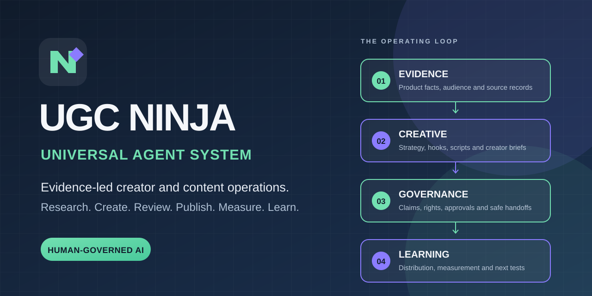

# UGC Ninja Agent Starter

### A human-governed AI starter for evidence-led UGC and creator workflows.

**Research → Strategy → Brief → Review → Learn**

[Quick start](#quick-start) · [What is included](#what-is-included) · [Governance](#human-approval-is-built-in) · [Contribute](CONTRIBUTING.md) · [Release notes](RELEASE_NOTES.md) · [Brand guide](docs/BRAND_AND_USAGE.md)

---

## Make the work behind creator content easier to inspect

AI can draft content quickly. A dependable content operation also needs verified product facts, audience evidence, rights-cleared material, a clear approval path and a way to learn from the result.

UGC Ninja Agent Starter is a small, open-source demonstration of that operating model. It includes three portable Agent Skills, one end-to-end workflow example, a creator brief, an asset review checklist and a validator. It is intentionally small enough to inspect and adapt in a first session.

It is not the full private UGC Ninja system. The source playbook, internal operating records and full production framework are not included.

## Quick start

### Clone

`bash
git clone https://github.com/hmzainjamil/ugc-ninja-agent-starter.git
cd ugc-ninja-agent-starter
`

### Validate

Requires Python 3.10 or newer. No third-party Python packages are required.

`bash
python3 scripts/validate_showcase.py
`

Expected result:

`text
skills=3 json_files=1
PASS: public showcase structure, skill metadata, JSON, links and release-safety checks
`

### Try the workflow

1. Read [governed-agent basics](docs/GOVERNED_AGENT_BASICS.md).
2. Copy the [creator brief template](templates/creator-brief.md) and use synthetic or approved product facts.
3. Walk through the [product-to-content workflow](workflows/product-to-content.json).
4. Review the resulting asset with the [asset review checklist](templates/asset-review-checklist.md).
5. Use the three skill files as task instructions in a compatible agent host.

The skill files are portable Markdown. Installation paths and tool permissions differ between agent hosts. This starter does not install a host or grant any external permissions.

## What is included

| Component | What it does | Start here |
|---|---|---|
| UGC Ninja Orchestrator | Turns a multi-step request into a scoped plan, owner map and approval gates | [Skill](skills/ugc-ninja-orchestrator/SKILL.md) |
| Content Strategy | Converts approved facts and audience evidence into pillars, formats and testable concepts | [Skill](skills/content-strategy/SKILL.md) |
| Creator Brief Review | Checks truth, deliverables, disclosures, rights and acceptance criteria | [Skill](skills/creator-brief-review/SKILL.md) |
| Product-to-content workflow | Demonstrates the path from objective and evidence to a reviewed creator brief | [Workflow JSON](workflows/product-to-content.json) |
| Creator brief template | Gives teams a consistent briefing record | [Template](templates/creator-brief.md) |
| Asset review checklist | Captures pre-publication checks and the exact asset approval | [Checklist](templates/asset-review-checklist.md) |

## Human approval is built in

The skills can research, plan, draft and prepare review records. They do not independently publish content, contact creators, sign agreements, grant rights, change budgets, pay people, change account access or delete records. A connected tool does not create approval authority.

Treat these as separate checks:

1. Is the tool technically available?
2. Is the connected account authorised for the data and operation?
3. Is the action permitted for this product, audience, market and platform?
4. Has the authorised person approved the exact action and final version?
5. Can the result be verified and, where possible, reversed?

Any unresolved product claim, rights scope, disclosure, eligibility, privacy basis or approval owner blocks release.

## Who this is for

- Growth and performance creative teams that need better evidence-to-creative handoffs.
- Creator operations teams that need consistent briefs and rights checks.
- Agencies that want a small, inspectable workflow starter.
- Agent builders who want a practical example of human approval boundaries.

## What this starter is not

- Not a hosted application, managed service or production connector.
- Not a guarantee of viral reach, downloads, conversions or revenue.
- Not legal, tax, financial, medical or platform-policy advice.
- Not the full UGC Ninja private operating system.
- Not a source of verified customer outcomes or live campaign benchmarks.
- Not permission to reuse third-party footage, music, likenesses, trademarks or claims.

## Project status

This public starter is a maintained example package. The included validator checks its structure, skill metadata, JSON, relative links and basic release-safety conditions. It does not test a live agent host, production connector, platform policy interpretation or real campaign.

See [release notes](RELEASE_NOTES.md), [public release checklist](docs/PUBLIC_RELEASE_CHECKLIST.md), [brand guide](docs/BRAND_AND_USAGE.md), [contributing](CONTRIBUTING.md), [support](SUPPORT.md) and [security](SECURITY.md). Use GitHub Issues for reproducible defects and questions that do not contain private information.

## License and brand

The source files in this starter are released under the MIT License. The UGC Ninja name and visual marks remain brand identifiers. The licence does not grant permission to imply endorsement or official affiliation. See [LICENSE](LICENSE).
